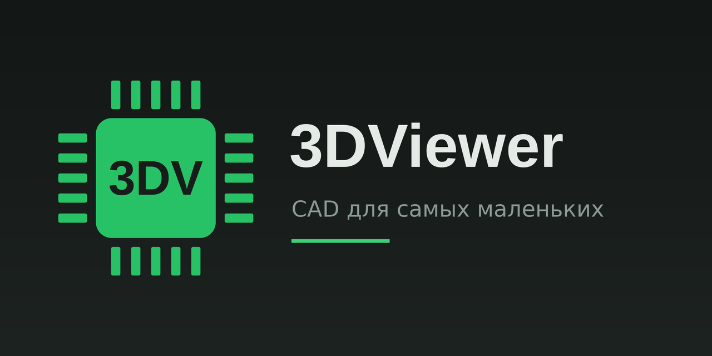

Простая программа для 3D на ПК: открыть модель почти любого формата, раскрасить, сделать несложную деталь и сохранить в STEP с цветами.

  <a href="https://github.com/Carn1son/3DViewer/releases/latest/download/3DViewer-Setup.exe"><b>Windows — установщик</b></a> ·
  <a href="https://github.com/Carn1son/3DViewer/releases/latest/download/3DViewer-portable.exe"><b>Windows — без установки</b></a>

## Возможности
- **Открытие:** STEP/STP, IGES/IGS, BREP — точная геометрия (OpenCascade); STL, OBJ+MTL, GLB/GLTF, FBX, DAE, 3DS, PLY, 3MF, AMF, VRML/WRL, OFF, VTK, USDZ, LWO, KMZ, PCD, XYZ; проект `.3dv`. Несколько файлов — в одну сцену.
- Закрытые форматы (SolidWorks .SLDPRT/.SLDASM, Parasolid, Inventor, CATIA, Creo, NX…) распознаются, программа подсказывает, как сохранить их в STEP.
- **Оформление:** цвет, металличность, шероховатость, прозрачность — для тела, грани или всего компонента. Пипетка (I) → кисть (B), копировать/вставить оформление (Ctrl+Shift+C/V), замена цвета во всей сцене, библиотека (пластики, металлы, маски плат, светодиоды…), недавние цвета.
- **Эскиз → тело:** эскиз на плоскости XY/XZ/YZ или на плоской грани (линия, дуга по 3 точкам, прямоугольник, окружность, многоугольник, привязки, ввод размеров с клавиатуры), затем вытянуть / повернуть / вырезать / добавить к телу. Вытягивание грани.
- **Измерение:** привязка к вершинам, серединам, центрам отверстий, рёбрам и граням; расстояние и отдельно ΔX/ΔY/ΔZ линиями, перпендикуляр до плоскости грани.
- **Моделирование:** коробка, пластина со скруглёнными углами, цилиндр, труба, сфера, конус, тор, призма; перемещение и поворот (мышью и числами), линейный и круговой массив, зеркало (в т.ч. относительно грани), масштаб, объединение / вычитание / пересечение, скругление и фаска, отмена/повтор.
- **Экспорт:** STEP AP214/AP242/AP203 (точная геометрия, цвета тел и граней, имена, мм), BREP, STL (с цветами), 3MF, OBJ+MTL, GLB, PLY, проект .3dv.
- Измерение расстояний, виды (Ctrl+1…7), перспектива/ортогональ, тёмная и светлая тема, русский и английский.

## Сборка
- Веб-версия: `python3 src/build.py` → папка `www/`, открыть `www/index.html` в Chrome/Edge.
- Windows: каждый push в `main` собирает установщик и portable .exe через GitHub Actions и выкладывает их в Releases.

Ядро: Open CASCADE Technology (LGPL-2.1) через replicad-opencascadejs и occt-import-js; графика: three.js (MIT). Лицензии — в `src/vendor/`.
