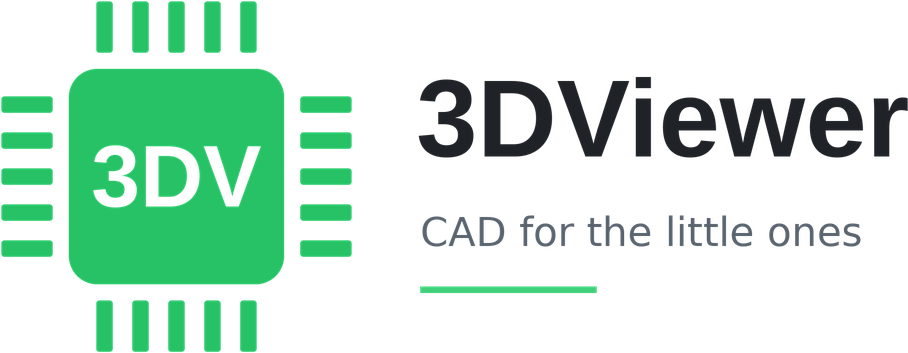

<picture><source media="(prefers-color-scheme: dark)" srcset="docs/logo-dark.png"></picture>

Lightweight 3D viewer and editor for Windows. Open, colour, model and export to STEP.

  <a href="https://github.com/Carn1son/3DViewer/releases/latest/download/3DViewer-Setup.exe"><b>Windows Installer</b></a> ·
  <a href="https://github.com/Carn1son/3DViewer/releases/latest/download/3DViewer-portable.exe"><b>Windows Portable</b></a>

## Features

### Import
- STEP, IGES, BREP with exact geometry and colours
- STL, OBJ, GLB, GLTF, FBX, DAE, 3DS, PLY, 3MF, AMF, VRML, OFF, VTK, USDZ
- Native `.3dv` projects
- Multiple files into one scene
- Automatic alignment and centering on import

### Appearance
- Colour, metalness, roughness and opacity per body or face
- Eyedropper and paint brush
- Copy and paste appearance between models
- Material library and saved palettes

### Modeling
- Sketches on planes or faces, extrude, revolve, cut
- Primitives, booleans, fillets and chamfers
- Move, rotate, mirror, scale
- Linear and circular patterns
- Face pull and face-to-plane alignment

### Measurement
- Snapping to vertices, edges, faces and hole centres
- Distance with ΔX, ΔY, ΔZ components

### Export
- STEP AP203, AP214, AP242 with body and face colours
- Altium Designer compatible colours
- BREP, STL, 3MF, OBJ, GLB, PLY

### Application
- Dark and light themes
- English and Russian interface
- Automatic updates

## Build
- Web: `python3 src/build.py`
- Windows: WebView2 wrapper in `src/win`, built by GitHub Actions on every push to `main`

## License
- Open CASCADE Technology, LGPL-2.1
- three.js, MIT
